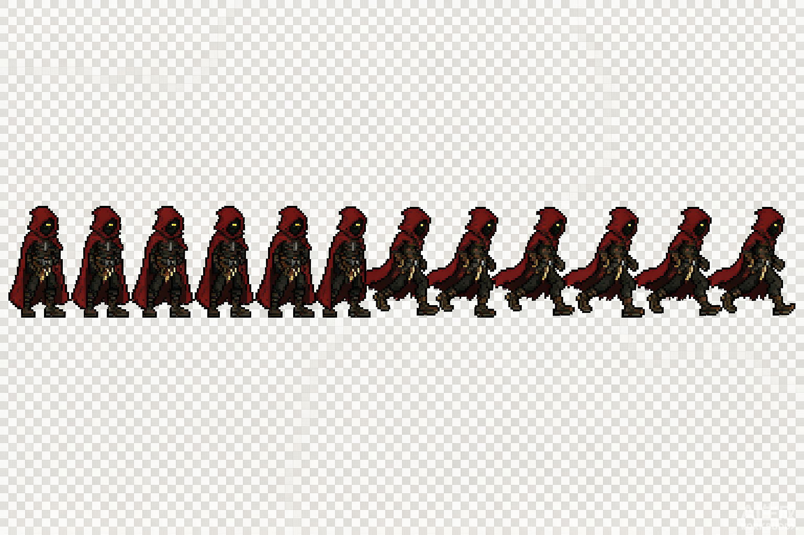
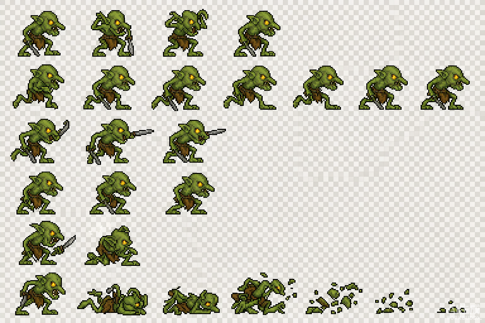
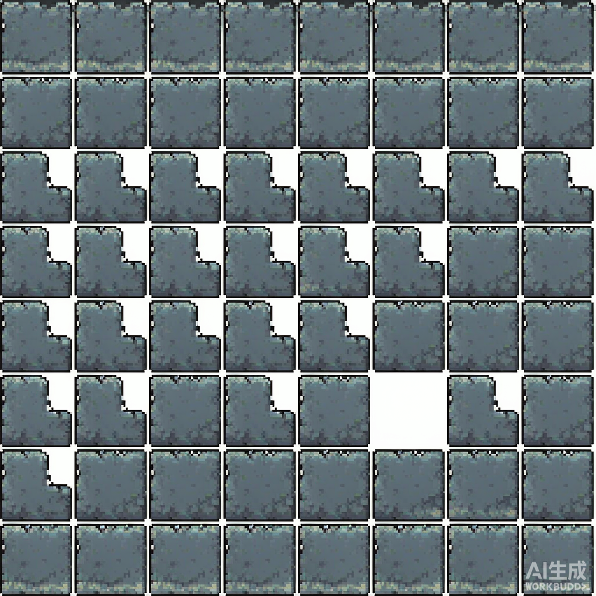
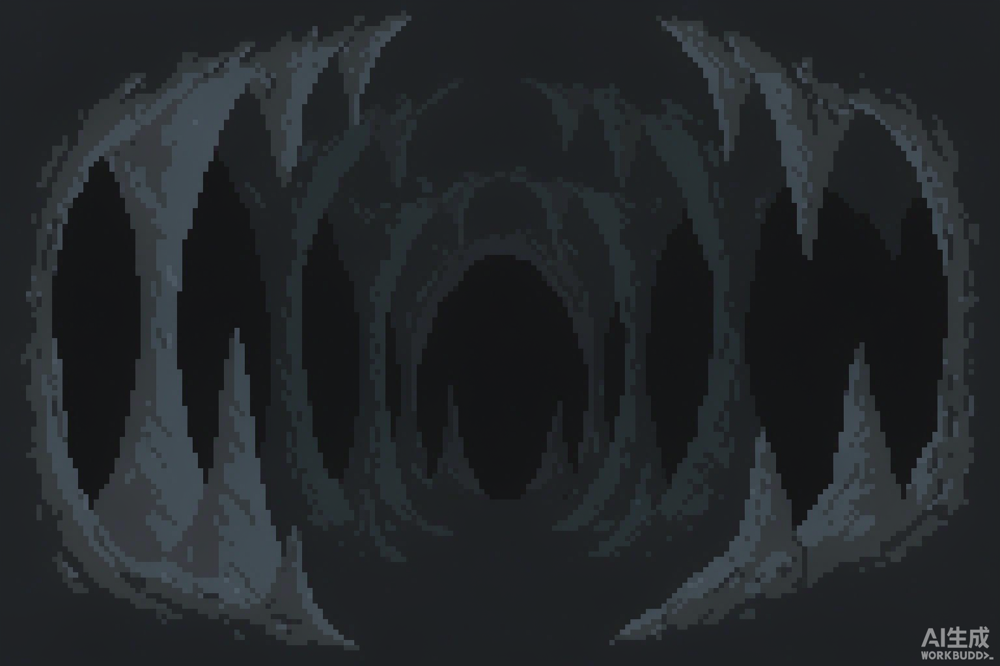
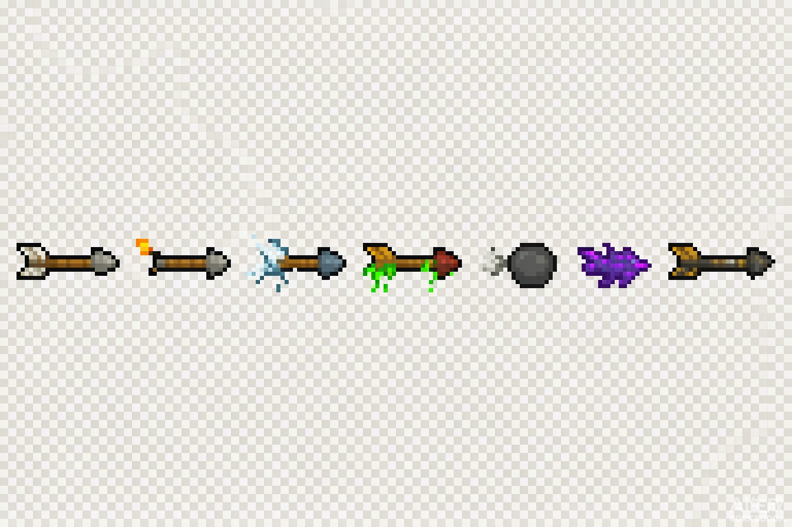

# CaveCrawler-Unity · 洞窟 Roguelike 平台动作原型

> 一个用 Unity 从零实现的 **2D 洞窟探索平台动作原型**。机制设计对标经典 Roguelike 平台动作作品（Caveblazers，2017，原作为 GameMaker 实现），**本项目仅复刻其公开玩法机制与手感，不含原作任何代码、贴图与音频资产**——全部代码为 C# 重写，全部美术为原创生成。
>
> 定位：**面试作品集 / 技术验证原型**。重点展示的是架构分层、手感调校、程序化生成与性能优化的工程能力，而非美术完成度。

| 项 | 值 |
|----|----|
| 引擎 | Unity **2022.3.62f3c1 LTS** |
| 渲染管线 | URP 2D（Universal Render Pipeline） |
| 语言 | C# (.NET Standard 2.1) |
| 代码规模 | 43 个 `.cs`，约 6800 行 |
| 状态 | **可 Play 的垂直切片**（v0.6.0） |

---

## 一、演示效果

| 玩家动作帧（待机 / 奔跑） | 敌人（哥布林） |
|---|---|
|  |  |

| 洞窟瓦片集 | 视差背景 | 投射物 |
|---|---|---|
|  |  |  |

上表为已生成并接入工程的**原创像素素材**（AI 生成 + 程序化清洗：去背景、去水印、按实测矩形切帧）。运行时通过 `Resources/CB/Art/` 加载，导入设置统一为 Point 过滤 / 无压缩 / PPU 16，保证像素不被插值糊掉。

> **降级设计**：所有美术接入点都做了「取不到素材 → 回退占位色块」的兜底，因此工程在缺少任何贴图的情况下依然可编译、可运行。

> 📌 待补充：运行时实机截图 / GIF 演示（Play 后截取）。

---

## 二、核心功能清单

**角色控制**
- ✅ 左右跑动（带加减速与摩擦，非瞬时速度）
- ✅ 跳跃 / **二段跳**
- ✅ **爬墙**（贴墙下滑 / 上爬，按方向键贴墙触发；离墙 **蹬墙跳**）
- ✅ **下落攻击**（空中下砸，落地产生范围冲击与击退）
- ✅ 可变跳跃高度（短按小跳）、**土狼时间**、**跳跃输入缓冲**
- ✅ 空中横向操控微调

**战斗**
- ✅ 近战 **三段连击**（第三段伤害 ×1.8、击退 ×2.5）
- ✅ 命中判定、击退、无敌帧、**顿帧（hitstop）**
- ✅ 远程武器体系：15 把弓 + 4 把近战，数值按原作公开数据表录入
- ✅ 抛物线投射物、穿透、爆炸
- ✅ **远程方向控制**：以移动/方向键做 8 向瞄准（Idle 时回退为面朝方向），命中倍率/射速/额外箭矢由装备与祝福聚合
- ✅ **投掷物**：将手持近战武器甩出为旋转飞行道具，命中造成伤害后**落地回收为可拾取武器**，永不丢失

**敌人**
- ✅ 近战追击型（哥布林 / 兽人）
- ✅ 飞行型（洞穴蝠：盘旋 → 预警 → 俯冲）
- ✅ 远程型（弓手：保持距离射击）
- ✅ **网格 A\* 寻路**，带视线与攻击距离判定

**关卡**
- ✅ 瓦片洞穴随机生成（房间 + 走廊开挖）
- ✅ **连通性校验**（洪水填充，保证出生点 → 出口可达）
- ✅ 出口传送门、逐层推进
- ✅ Tilemap 渲染 + 视差背景层

**系统**
- ✅ 生命 / 受伤 / 无敌帧 / 死亡
- ✅ **背包与武器切换**：近战 / 弓各持有独立背包（上限 6），换装不丢旧武器；`Q` 循环切近战、`G` 循环切弓，HUD 显示完整武器清单与手持项
- ✅ **装备系统**：戒指（2 槽）/ 法器（2 槽）/ 雕像（1 槽），击杀掉落或基座产出；装备与祝福的增益通过**聚合修正器**统一结算到移速、伤害、射速、生命、击退、吸血、爆裂等维度
- ✅ **祝福系统**：祝福神龛（`E` 祈祷）随机授予尚未拥有的祝福（生命 / 迅捷 / 强力 / 箭术 / 狂热 / 神跃 / 财富 / 嗜血 / 壁垒 / 风暴 / 毁灭 / 巨力共 12 种）
- ✅ 拾取物：金币（受财富增益）、药水（回血）、武器、装备
- ✅ 宝箱、物品基座（换武器 / 取装备）、祝福神龛、传送门
- ✅ HUD（生命、弓/投掷冷却、**武器背包清单**、装备、祝福、控制图例）
- ✅ 固定步模拟时钟 + 相机跟随
- ✅ **原创像素美术接入**（角色/敌人/瓦片/投射物/拾取物/特效帧动画，**含优雅降级**）
- ✅ 视差背景层
- ⏳ 2D 光照（火把点光 + 冷蓝环境光）· 洞窟装饰撒点 · 敌人死亡动画（进行中）

---

## 三、技术栈

| 层 | 选型 | 理由 |
|----|------|------|
| 引擎 | Unity 2022.3 LTS | 长期支持版，URP 2D 稳定 |
| 渲染 | URP 2D + 正交相机 | 像素风基准；后续接 `Light2D` 做火把光照 |
| 物理 | **自研 AABB–tile 碰撞**（未用 `Rigidbody2D`） | 平台游戏需要完全确定性的碰撞与"贴地/卡角"控制 |
| 输入 | Legacy `Input`（+ 自研边沿锁存层） | 后续可无痛切换到 Input System |
| 数据 | `ScriptableObject` 武器定义 | 数据驱动，数值与逻辑分离 |
| 程序集 | **未使用 asmdef**（全部在 `Assembly-CSharp`） | 见「技术难点 ⑥」的取舍说明 |

---

## 四、目录结构

```
.
├── Assets/
│   ├── CB/                     # 全部游戏代码（33 个 .cs）
│   │   ├── Core/               # 基础设施：时钟、输入、配置、引导、相机、占位资源
│   │   ├── World/              # 瓦片世界、自研刚体、A* 寻路、洞穴生成、Tilemap 渲染
│   │   ├── Entities/           # Actor 基类、注册表、玩家控制器/战斗、三类敌人
│   │   ├── Combat/             # 投射物、爆炸、特效（池化）
│   │   ├── Weapons/            # 武器 ScriptableObject 定义 + 武器库
│   │   ├── Items/              # 拾取物、宝箱、物品基座、传送门
│   │   └── UI/                 # IMGUI HUD
│   ├── Scenes/                 # 初始场景（Play 即可，无需手工搭建）
│   └── Settings/               # URP 资源与 2D 渲染器配置
├── Docs/
│   └── images/                 # README 用演示图
├── Packages/                   # 依赖清单（URP、2D 相关包）
├── ProjectSettings/            # Unity 工程配置
├── .gitignore                  # Unity 标准忽略规则 + 敏感配置排除
└── LICENSE                     # MIT
```

**分层依赖方向**（无环）：
```
Core  ←  World  ←  Entities  →  Combat / Weapons / Items  →  UI
                              ↘  Core
```

---

## 五、各模块实现思路与技术难点

### ① 架构设计：固定步时钟与渲染帧解耦

**问题**：直接在 `Update` 或 `FixedUpdate` 里写玩法逻辑，会让手感随显示器刷新率漂移（60Hz / 144Hz 表现不一致），也让命中判定不可复现。

**做法**：`Core/CBGameClock.cs` 用**累加器**驱动固定步：

```csharp
_acc += Time.deltaTime;
while (_acc >= H && steps < MaxSteps) { Step(H); _acc -= H; steps++; }
```

- 步长 `H = 1/60 s`，单帧最多 5 步（防死亡螺旋）；
- 所有玩法逻辑（移动、攻击判定、投射物、AI）统一注册到固定步；
- 渲染与插值在 `Update / LateUpdate`（相机跟随）进行。

**收益**：手感与帧率无关；顿帧（hitstop）只需暂停时钟推进，不需要改任何玩法代码。

### ② 技术难点：边沿输入会被固定步"吞掉"

**现象**：跳跃用 `Input.GetKeyDown`，在高刷新率下经常"按了没反应 / 只能跳一次"。

**根因**：`GetKeyDown` 只在**按下那一渲染帧**为真，而固定步每帧执行 0~5 次——按键那一帧若一次固定步都没轮到，本次输入直接丢失。

**解决**：`Core/CBInput.cs` 做**输入锁存**：
- `Update()` 每渲染帧捕获边沿输入（跳跃 / 攻击 / 交互）写入锁存位；
- 固定步回调只**消费**锁存位，不直接读 `GetKeyDown`；
- 长按类输入（移动、按住射击）不受影响，仍在固定步读。

**收益**：一套修复同时解决了跳跃、换弹、切武器等所有边沿输入的丢帧问题。

### ③ 平台跳跃手感：四项"隐形"调校

手感不是调一个重力值，而是四个开关的组合（`Core/CBConfig.cs` 全部可调）：

| 机制 | 值 | 解决什么 |
|------|----|---------|
| **土狼时间** (Coyote Time) | 0.10 s | 刚走出平台边缘仍可起跳，消除"明明按了却没跳" |
| **跳跃输入缓冲** (Jump Buffer) | 0.12 s | 落地前按下也算，消除"差一帧没接上" |
| **短按跳削减** | ×0.45 | 松键立刻削减上升速度 → 可变跳跃高度 |
| **下落重力倍率** | ×1.35 | 下落比上升快，跳跃不"飘" |

配合起跳初速 16.6 u/s、二段跳 14.6 u/s（略低于首跳，避免二段跳变成更强的位移手段）。

### ④ 碰撞：为什么不用 Rigidbody2D

平台动作游戏对碰撞的要求是**可预测**：贴地不能抖、上坡不能卡、高速不能穿墙。内置 2D 物理为通用性做了大量妥协（求解器迭代、接触点抖动）。

因此自研 `World/CBBody.cs`：
- AABB 与 tile 网格**分轴扫描**（先 X 后 Y），天然避免斜向穿透；
-  grounded 判定用**脚下探测**而非碰撞回调（不与物理步耦合，出生即正确）；
- 起跳后短暂禁用判地，防止贴地连跳。

### ⑤ 关卡生成：随机但必须可解

`World/CBCaveGenerator.cs`：房间 + 走廊开挖 → **洪水填充校验连通性** → 不连通则打通或重生成。

**为什么必须校验**：程序化生成的经典事故是"生成了一张看起来不错但走不通的图"。把可解性做成生成流程的**硬约束**，而不是靠调参碰运气。

### ⑥ 技术难点：程序集（asmdef）的取舍

早期版本采用 5 层 asmdef 分层，结果是：**任何一处编译错误都会引发 Burst "Failed to resolve assembly" 的连锁报错刷屏**，排查成本极高。

本项目因此**刻意不使用 asmdef**，全部代码在 `Assembly-CSharp` 下，靠**目录 + 命名前缀（CB*）+ 依赖方向**约束分层。

> 这是一个**权衡后的决定**：牺牲编译隔离带来的增量编译速度，换取极低的排错成本与更快的迭代。若后续代码规模增长到需要按程序集拆分，应同步引入 CI 编译检查。

### ⑦ 性能优化

| 手段 | 落地位置 | 说明 |
|------|---------|------|
| **对象池** | `Combat/CBFx.cs`、投射物 | 特效 / 子弹复用，避免频繁 `Instantiate` |
| **零 GC 查询** | `CBUtil` 的重叠查询 | 用 `NonAlloc` 版本 + 复用缓冲数组 |
| **注册表代替查找** | `Entities/CBActorRegistry.cs` | 命中查询不再每帧 `FindObjectsOfType` |
| **固定步上限** | `CBGameClock` | 卡顿帧最多补 5 步，防死亡螺旋 |
| **Tilemap 批量渲染** | `World/CBLevelView.cs` | 整层一次设置 tile，不做逐格 GameObject |

### ⑧ 资源管理

- 运行时用 `Core/CBAssets.cs` 生成占位像素精灵（`Sprite.Create` + `SpriteMeshType.FullRect` + Sliced），**零外部依赖即可跑通**；
- 占位资源与玩法逻辑**解耦**：颜色 / 尺寸集中在 `CBAssets` 与 `CBConfig`，美术接入时只替换这一层，不动玩法代码；
- 大体积二进制（截图、字体、音频）不入库，`.gitignore` 已排除 `Library/`、`Temp/`、`Logs/`、`Obj/`、`Build/` 及 keystore / `.env` 等敏感配置。

### ⑨ 设计模式应用

| 模式 | 应用点 |
|------|--------|
| **状态机** | 玩家（idle / run / jump / fall / dive / attack / hurt / dead）；敌人（patrol / chase / windup / strike / recover） |
| **对象池** | 特效、投射物 |
| **注册表 / 服务定位** | `CBActorRegistry` 统一 actor 查询 |
| **数据驱动（ScriptableObject）** | `CBWeaponDef`：武器数值与逻辑分离 |
| **引导器（Bootstrap）** | `CBBootstrap` + `[RuntimeInitializeOnLoadMethod]`，运行时装配一切，场景零搭建 |
| **观察者（事件）** | 伤害 / 死亡 / 拾取事件广播，UI 与成就解耦 |

---

### ⑩ 增益聚合：装备与祝福如何落到数值上

装备（戒指 / 法器 / 雕像）与祝福的增益形状完全不同（有的乘算、有的加算、有的触发击杀特效），但都要同时影响移速、近战/远程伤害、射速、生命、击退、吸血、爆裂。若在每个玩法点各自 `if (有戒指X) ...` 会造成散落耦合。

本项目用一个 **`CBModifier` 聚合修正器** 统一表达：

- **加算字段**：`maxHP`、`jumpBonus`、`lifestealOnKill`、`extraArrows`、`knockbackResist`；
- **乘算字段**（默认 1）：`moveSpeedMul`、`meleeDamageMul`、`rangedDamageMul`、`fireRateMul`、`coinMul`；
- **触发字段**：`explosionOnKill`。

`CBLoadout` 持有装备槽与已得祝福，每次获得任意一件就调用 `Recompute()` 把所有来源的 `CBModifier.Add` 聚合成**一个** `Mods`。玩法代码只读 `player.Loadout.Mods.*`，例如：

```csharp
float moveSpeed = config.moveSpeed * Loadout.Mods.moveSpeedMul;
int maxJumps   = config.maxJumps  + Loadout.Mods.jumpBonus;
```

击杀时的吸血与爆裂也集中在一个 `OnKill(victim)` 里（`lifestealOnKill` 回血、`explosionOnKill` 触发 AOE），近战与投射物击杀共用同一条路径。

> 这是一处**显式取舍**：聚合层让"新增一件装备/祝福"变成"在库里加一条数据 + 一个 lambda"，玩法代码零改动。代价是所有增益必须经过该层，不能绕过直接改数值。

---

## 六、本地运行与打包

### 运行

1. 安装 **Unity Hub** 与 **Unity 2022.3.62f3c1 LTS**（安装时勾选 *Universal Windows Platform* 或 *Windows/Mac/Linux* 构建支持）
2. `git clone https://github.com/MENG429/CaveCrawler-Unity.git`
3. Unity Hub → *Open* → *Add project from disk* → 选择仓库根目录
4. 首次打开会执行资源导入（约 1–3 分钟）
5. 打开 `Assets/Scenes/SampleScene.unity`，**直接点 Play**

> 无需手工搭建场景：`CBBootstrap` 会在场景加载后自动生成时钟、相机、关卡与角色。

### 操作按键

| 功能 | 按键 |
|------|------|
| 左右移动 | `A` / `D`（或 ← / →） |
| 跳跃 / 二段跳 | `Space`（或 `W` / ↑） |
| **爬墙**（贴墙下滑/上爬） | 朝墙方向按住移动键；`W`/`S` 控制上爬/下滑 |
| **蹬墙跳** | 贴墙时按 `Space` |
| 近战攻击（三段连击） | `J`（或 `Z`） |
| 下落攻击（空中） | `S`（或 ↓）+ `J` |
| 弓（按住连射，**方向键瞄准**） | `K`（或 `X`）+ 方向键 |
| **投掷手持近战** | `L` |
| **切换手持近战** | `Q` |
| **切换手持弓** | `G` |
| 交互（开箱 / 取武器 / 神龛祈祷 / 传送门） | `E`（或 `F`） |
| 重开一局 | `R` |
| 重新生成当前层（调试） | `N` |

### 打包（Windows）

1. `File → Build Settings` → Platform 选择 **Windows, Mac, Linux** → Target Platform: **Windows**
2. `Add Open Scenes` 勾选 `SampleScene`
3. Architecture 选 `x86_64`，点击 **Build**，选择输出目录（建议 `Builds/Win64/`）
4. 产物 `CaveCrawler.exe`

> 构建产物目录 `Builds/` 已被 `.gitignore` 忽略，不会入库。

---

## 七、路线图（按优先级）

### 已完成

- [x] **原创像素美术接入**（15 张精灵表：清洗 → 显式帧表 → 运行时切帧，含优雅降级）
- [x] 视差背景层与瓦片贴图

### 进行中

- [ ] **2D 光照**：`Light2D` 火把点光 + 冷蓝环境光 + 玩家跟随光，确立"冷石与暖火"氛围
- [ ] **洞窟装饰撒点**：火把 / 钟乳石 / 骸骨 / 苔藓按种子随机布置
- [ ] **敌人死亡动画**：死亡帧播放后再销毁，替代立即消失

### 待办

- [ ] **HUD 像素化**：`ui_hud.png` 帧表已就绪，需从 IMGUI 迁移到 uGUI Canvas
- [ ] 正式 permadeath 与 Run 结算（当前为原地重开）
- [ ] 蓄力武器（Powitzer / Divine Bow）
- [ ] 敌人寻路升级为落点图 + 跳跃弧线（当前为地面网格）
- [ ] 音频系统接入

---

## 八、后续章节（预留结构）

> 以下内容将在后续迭代中补充，章节骨架先行预留：

- **性能剖析报告**：Profiler 采样数据、帧时间分布、GC 分配热点（计划：接入美术后做一轮）
- **Playtest 报告**：≥3 轮试玩记录、难度曲线与手感反馈归档
- **音频设计**：音乐基调、音效清单、混音策略
- **可访问性**：色盲档、闪烁控制、UI 缩放（规格已定，待实现）
- **本地化**：多语言文本表与切换流程
- **CI / 自动化**：编译检查与构建流水线的接入方案
- **测试**：单元测试与冒烟测试用例

---

## 九、已知限制

| 项 | 说明 |
|----|------|
| 美术 | 运行时仍为占位色块，原创素材尚未接入 |
| 音效 | 暂未接入 |
| 数值平衡 | 手感参数由反推 + 试跑校准得出，未做过系统性平衡测试 |
| 程序集 | 未做 asmdef 拆分（见「技术难点 ⑥」的权衡说明） |
| 平台 | 仅在 Windows + Unity 2022.3.62f3c1 验证过 |

---

## 十、许可证

[MIT](LICENSE) © 2026 MENG429

- 本项目为**学习与技术验证用途**的原型。
- 玩法机制属思想范畴，不受著作权保护；本项目**不包含**任何原作代码、贴图、音频或数据文件。
